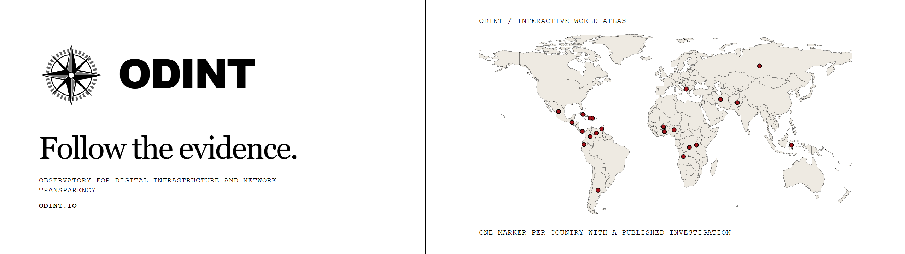
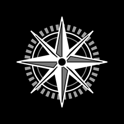
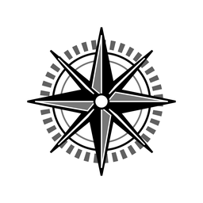
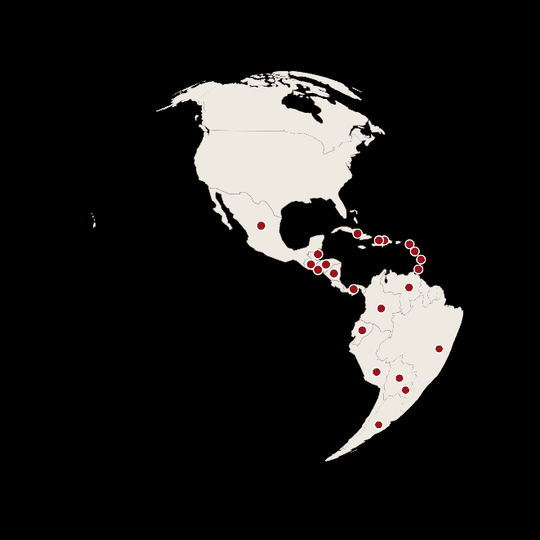

<picture>
  <source media="(prefers-color-scheme: dark)" srcset="brand/03-banner/odint-banner-black.png">
  <source media="(prefers-color-scheme: light)" srcset="brand/03-banner/odint-banner-white.png">
  
</picture>

# O-D-I-N-T/.github

The public front page of the **O.D.I.N.T.** GitHub organization (`profile/README.md`, shown on
[github.com/O-D-I-N-T](https://github.com/O-D-I-N-T)) and the org's brand kit. The website is
[odint.io](https://odint.io).

## `> brand_kit`

Everything follows the site's own design system (`DESIGN.md` and `ODINT_Claude_Handoff/` in the odint.io
repo). The mark is the master seal: ring, eight points and grey facets. It comes **positive** (black and grey
on white) or **inverse** (white and grey on black). Logos never carry red. Carmine `#A1121A` appears only on
map markers, and the old v1 red `#CC0000` is retired.

<table>
<tr>
<td width="25%" align="center"><br><sub><code>avatar · black</code></sub></td>
<td width="25%" align="center"><br><sub><code>avatar · white</code></sub></td>
<td width="50%" align="center"><br><sub><code>atlas globe loop</code></sub></td>
</tr>
</table>

| Folder | Files | Where it goes |
|:--|:--|:--|
| `01-profile-icon/` | `odint-avatar-<black\|white>-<size>.png`, 1024 to 64, seal with a 12% margin | org avatar (**black 1024**), any square icon |
| `02-logo/` | `odint-seal-*` and `odint-lockup-*`, positive and inverse, SVG plus PNG at 2048, 1024 and 512 | documents, decks, READMEs |
| `03-banner/` | `odint-banner-<black\|white>.png`, 2560x720 | README headers |
| `04-social-preview/` | `odint-social-<black\|white>-1280x640.png` | repo Settings > Social preview |
| `05-screenshots/` | odint.io home and Atlas at 1440 wide | READMEs, decks |
| `06-globe/` | `odint-atlas-globe.gif`, the site's own globe turning, plus a still | READMEs |
| `featured.json` | the investigations the homepage features, with their photographs | `profile/README.md` |

## `> rebuild`

```
py -3.13 scripts/make_art.py
```

The script rebuilds every file in `brand/` from the odint.io source folder
(`D:\03 Website Library\ODINT.io`). Headless Chromium loads the site's own logo SVGs, atlas map, pages and
MapLibre globe straight from disk, and nothing is fetched from the internet.

The script then copies the README media into `profile/assets/` under content-hashed names
(`banner-dark-<sha8>.png` and so on), refreshes the investigation strip from the homepage's featured set,
and relinks `profile/README.md`. GitHub's image proxy caches by URL, so a changed image has to get a new name.
